# MiniHex: a 9-DOF Motion Platform

A low-cost, 3D-printed 9-DOF motion platform, designed, simulated, built and tested for the Institute of Flight System Dynamics (FSD) at TU Munich as a small-scale prototype of its full-scale eVTOL motion simulator. A 6-DOF Stewart platform driven by rotary servos carries a 3-DOF gimbal that holds a Pixhawk 6C flight controller.

*Bachelor's thesis, "MiniHex: Designing a 9-DOF Motion Platform", TU Munich, Institute of Flight System Dynamics, 2025 (grade 1.3). Supervisor: Alexander Zwenig.*

<p align="center">
  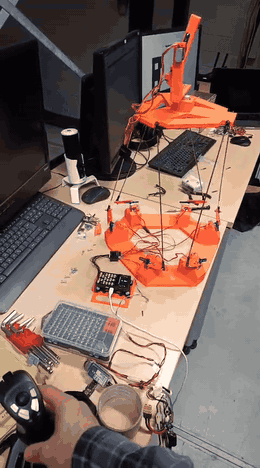
  &nbsp;
  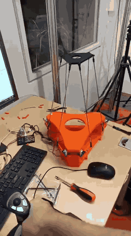
  &nbsp;
  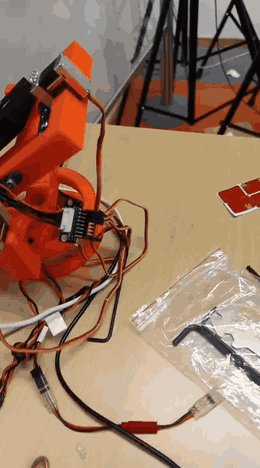
</p>

*Hardware: joystick-driven lower and upper stages (left), lower stage (middle), upper-stage gimbal (right).*

<p align="center">
  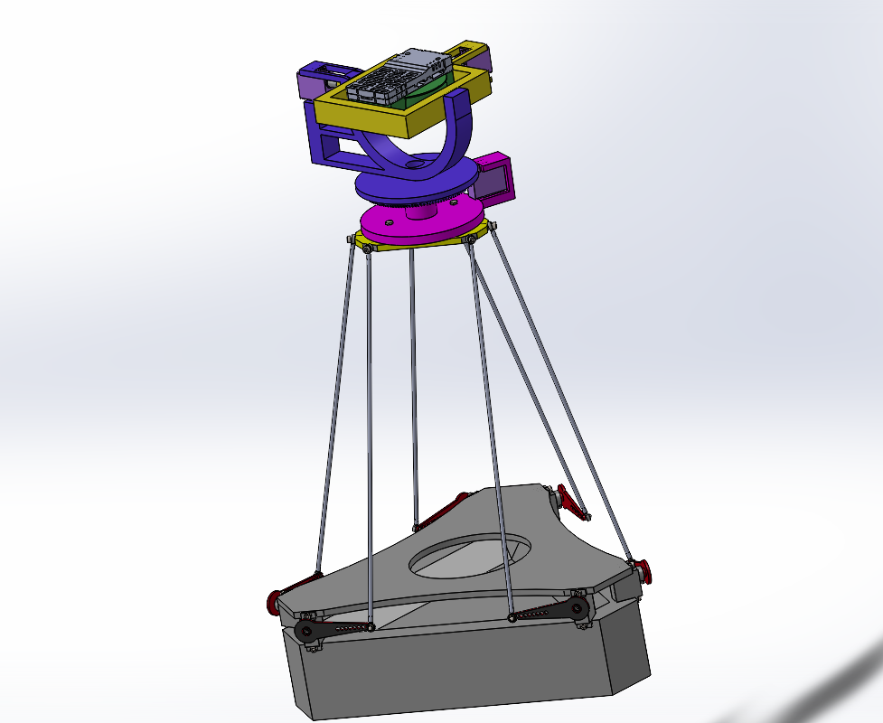
  &nbsp;
  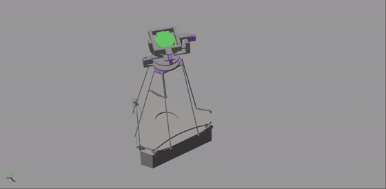
</p>

*Left: SolidWorks assembly. Right: Simscape Multibody simulation of the full platform.*

## Result at a glance

| | Requirement | Simulation (Simscape) | Hardware |
|---|---|---|---|
| Roll / pitch / yaw (lower stage) | ±20° | ±20° / ±20° / ±19° | ±26.5° / ±28.2° / −26.7° to +29.3° (Pixhawk IMU) |
| Translation X / Y / Z (lower stage) | ±50 mm | ±50 / ±48 / ±48 mm | about ±50 mm on all axes (measured with a ruler) |
| Servo torque | < 10 kg·cm | peak about 0.8 kg·cm (12× margin) | n/a |
| Tracking error (simulation vs command) | n/a | RMS ≤ 0.26° and ≤ 0.46 mm, max 1.17° and 2.86 mm | n/a |
| Upper gimbal pitch / roll / yaw | no strict target | ±30° commanded | −41.9° to +46.4° / ±51.1° / about ±11° |

The platform is driven **open-loop**: there is no closed-loop motion-cueing controller. Rotations were measured with the Pixhawk IMU, translations only by hand, since the IMU gives no position. The upper-stage yaw range is limited by the servo and the gear linkage.

## System

| | Lower stage | Upper stage |
|---|---|---|
| Mechanism | 6-DOF Stewart platform, 6 rotary servos, fixed-length rods | 3-DOF gimbal (roll, pitch, yaw), one servo per axis |
| Actuators | 6× FrSky Xact Mini Servo HV M 5253H | 3× FrSky Xact Mini Servo HV M 5252H |
| Payload | upper stage | Pixhawk 6C |
| Parts | 3D-printed pivots and horn attachments, M3 rods and ball joints | 3D-printed rings and base plate, gear drive for yaw |

**Design requirements:** about ±20° in roll, pitch and yaw, ±50 mm translation, actuator torque below 10 kg·cm, all parts within the build volume of a Prusa XL, and only off-the-shelf components and 3D-printed parts. See [`docs/bill_of_parts.md`](docs/bill_of_parts.md).

## What the engineering looked like

The design went through several loops of design, print, test and redesign. The four that mattered most:

**1. 3D-printed servo splines failed under load.**
The 3D printer could not reliably reproduce the fine spline of the servo shaft. A press-fit printed horn worked at first, then deformed under load and came loose. The fix was a hybrid: a purchased metal horn for the critical spline interface plus a printed attachment for the required geometry. The same lesson was applied to the upper stage.

<p align="center">
  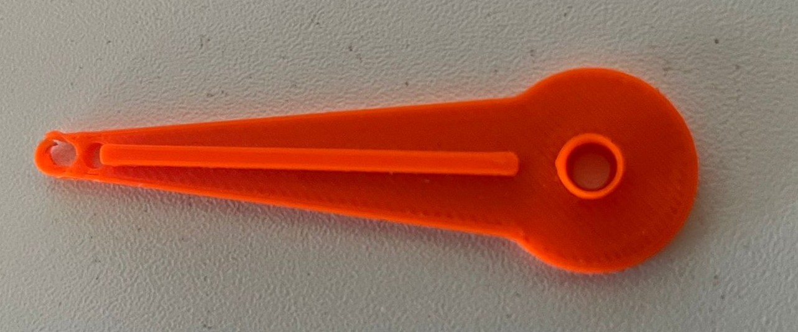
  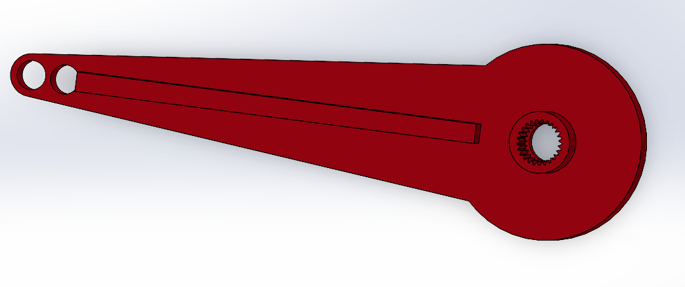
  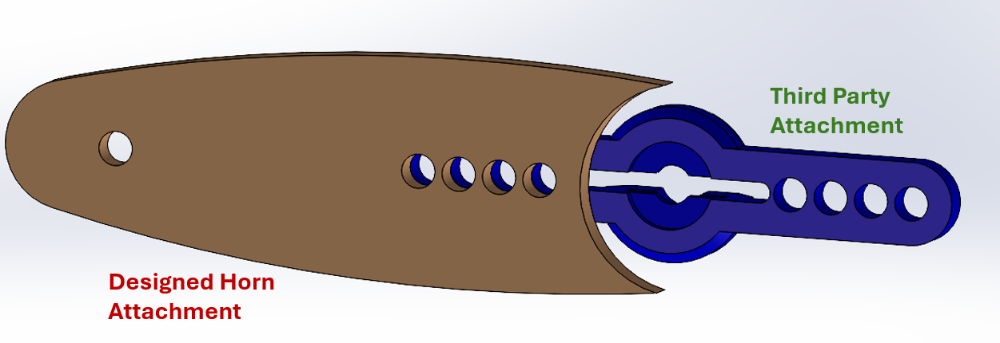
</p>

**2. The lower stage was simplified after failed prints.**
The original lower static pivot had excessive material and complex features and failed repeatedly in print. Removing the unnecessary geometry and simplifying the structure fixed it.

<p align="center">
  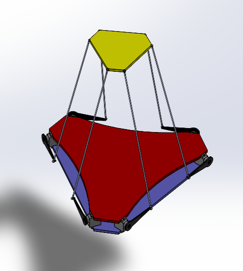
  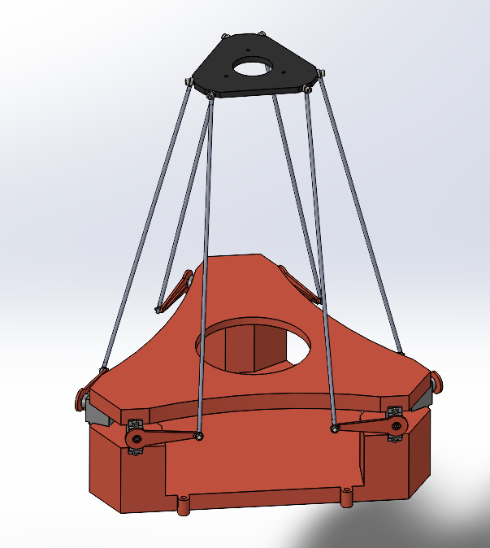
  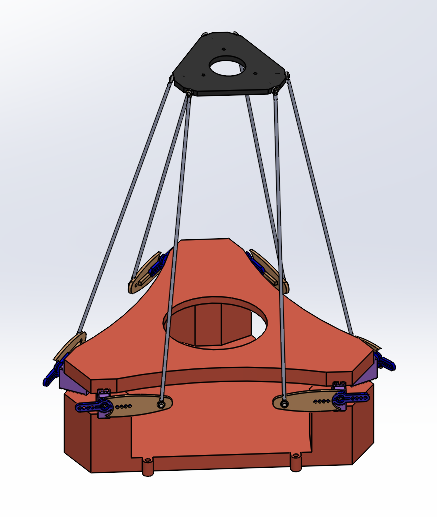
  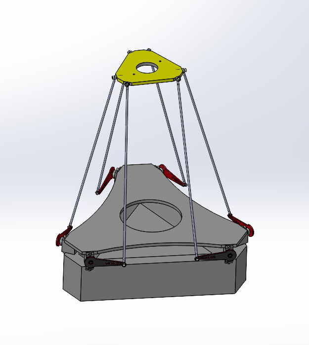
</p>

**3. The CAD export was not usable as a simulation model.**
Exporting the SolidWorks assembly to Simscape Multibody (via the Simscape Multibody Link plugin) replaced the ball joints with rigid or prismatic connections and flipped the dynamic pivot, which left unsolved kinematic constraints. Everything except the imported solid bodies had to be redone: rigid sub-parts were grouped to remove redundant blocks, the joints were recreated, and coordinate frames were added manually to every rigid body.

<p align="center">
  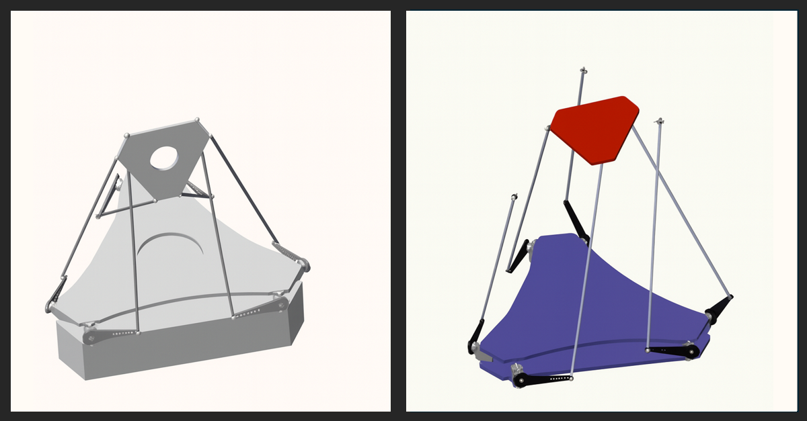
  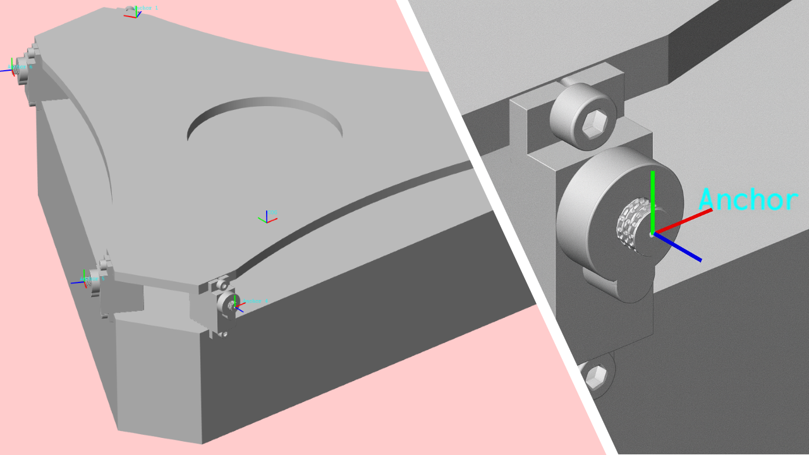
</p>

**4. Step inputs gave meaningless dynamics.**
Scalar (step) pose commands produced abrupt servo motion, large torque spikes and unrealistic transients. Replacing them with smooth, time-continuous trajectories gave realistic servo motion and stable torques.

<p align="center">
  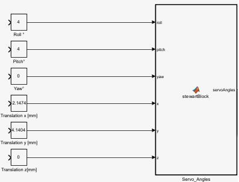
  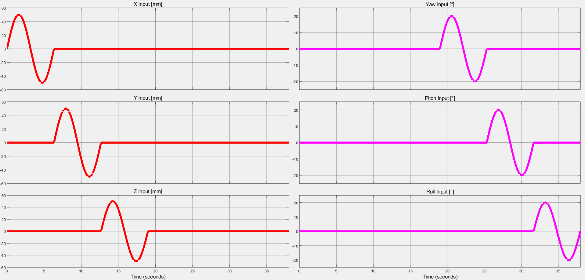
</p>

The CAD is parametric (SolidWorks equations), and the pivot anchor points from the kinematics sketch were projected onto the CAD model to map the mechanical design directly onto the solver inputs. A few examples:

<p align="center">
  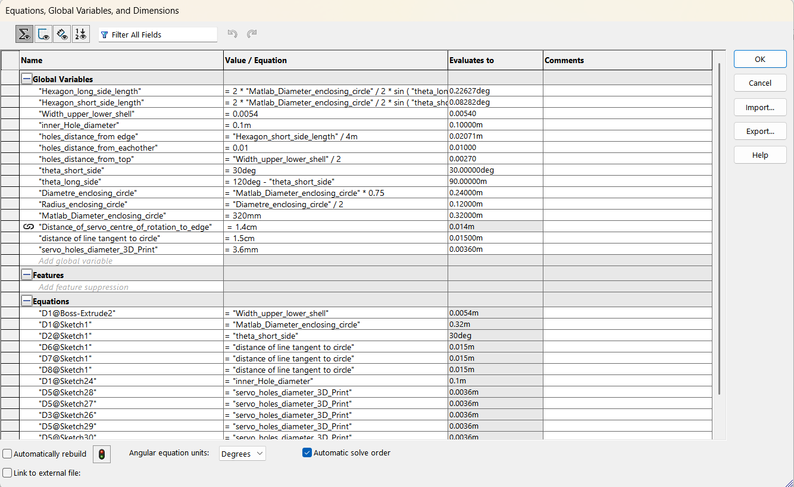
  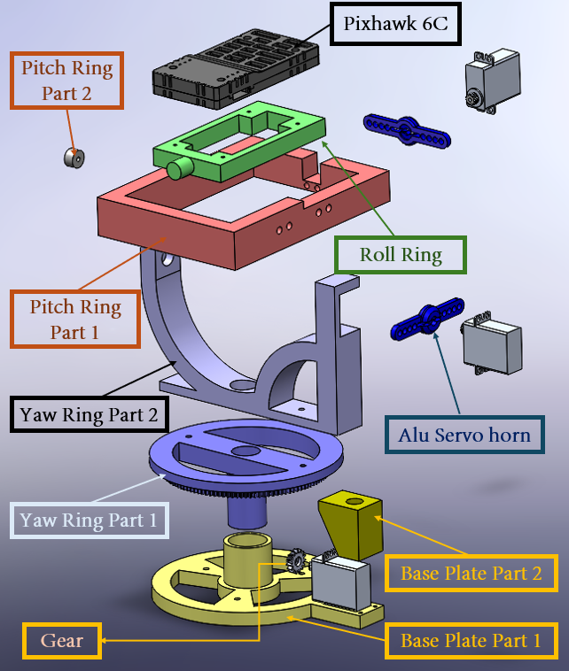
  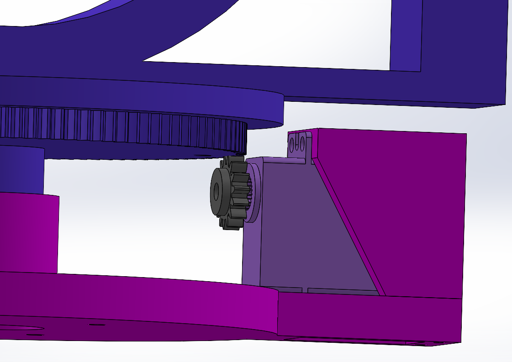
</p>

## Simulation

The motion pipeline in Simulink: a reference pose `[roll pitch yaw x y z]` goes to the inverse-kinematics block, which returns six servo-horn angles; these drive the revolute joints of the Simscape Multibody model, and the platform pose is compared with the command. The upper stage is driven directly with joint angles (no inverse kinematics).

Test signals: single-cycle sinusoids of ±20° and ±50 mm per axis for the lower stage, persistent ±30° sinusoids for the upper stage.

| DoF | Max | Mean | Median | RMS |
|---|---|---|---|---|
| Pitch [°] | 0.225 | 0.031 | 0.060 | 0.057 |
| Roll [°] | 0.427 | 0.064 | 0.023 | 0.100 |
| Yaw [°] | 1.167 | 0.104 | 0.0007 | 0.256 |
| X [mm] | 1.984 | 0.179 | 0.0002 | 0.442 |
| Y [mm] | 2.253 | 0.343 | 0.242 | 0.459 |
| Z [mm] | 2.857 | 0.031 | 0.031 | 0.086 |

The residual error comes from the difference between the idealised kinematic model (rigid bars) and the Simscape model with solid bodies, and from small frame inconsistencies in the CAD-to-Simscape transfer. Y and Z translation and yaw saturate near ±48 mm and ±19° because of frame collisions and linkage reach. Peak servo torque was about 0.8 kg·cm; the few outliers are likely numerical (the solver's second-derivative estimate).

<p align="center">
  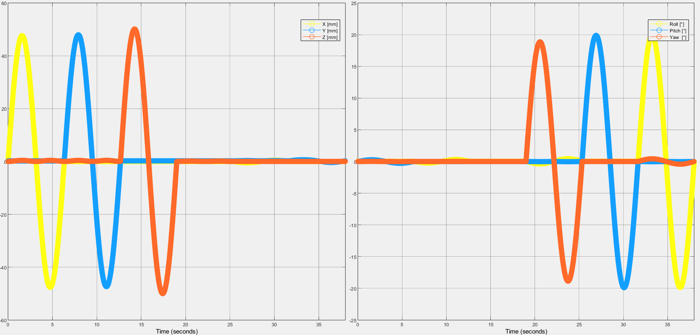
  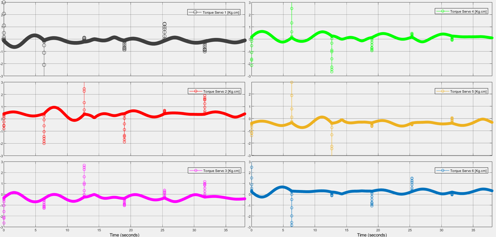
</p>

## Hardware tests

<p align="center">
  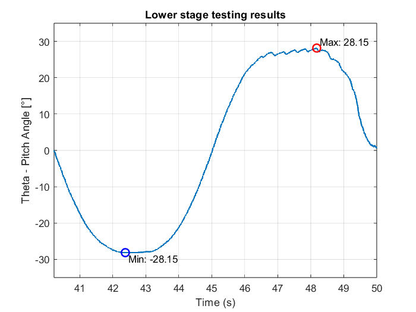
  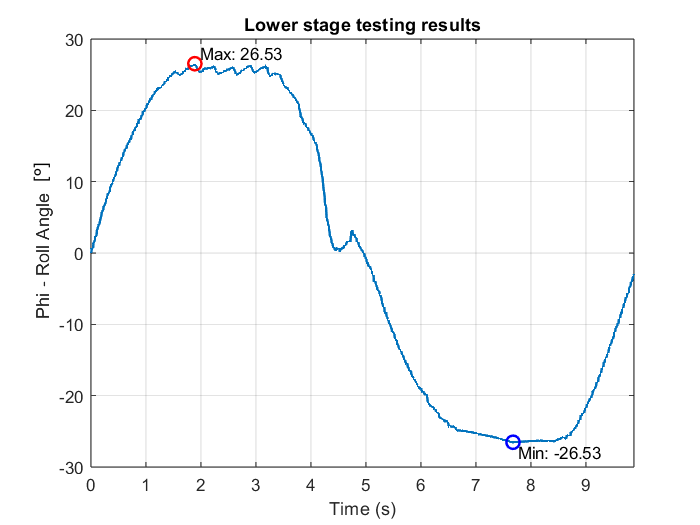
  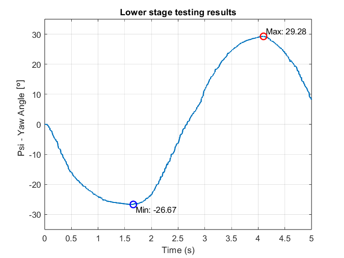
</p>
<p align="center">
  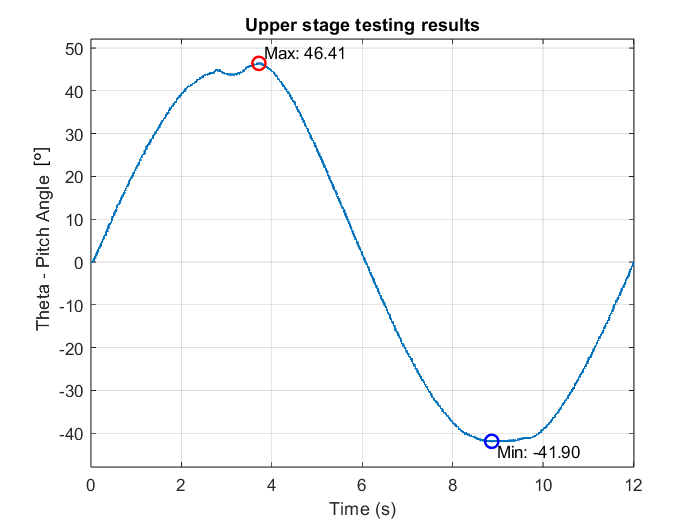
  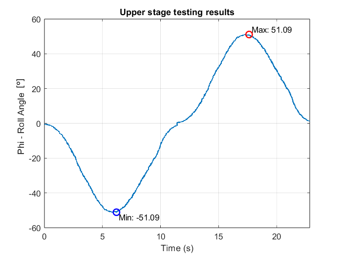
  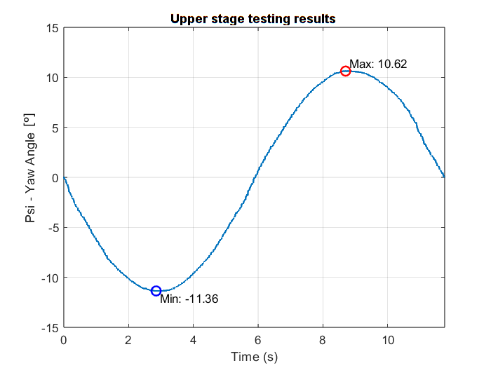
</p>

*Top: lower stage pitch, roll, yaw. Bottom: upper stage pitch, roll, yaw (Pixhawk IMU).*

Lower-stage yaw is not symmetric (−26.67° to +29.28°) because of occasional sensor problems and the free play of the ball joints before the horn drives the dynamic pivot.

## Limits

- Open-loop actuation only; no closed-loop motion-cueing controller.
- Translation was measured with a ruler, not a sensor; only rotations have sensor data.
- Upper-stage yaw is limited to about ±11° by the servo and the gear linkage. A continuous-rotation servo or a different actuation layout would fix this.
- The CAD used in the Simscape model is not identical to the final printed upper-stage and lower-stage geometry; the thesis judges the effect on motion and torque results to be small.
- The platform is a laboratory prototype for motion-control development, not a replacement for the full-scale simulator.

## Repository layout

```
media/                        hardware and simulation clips (GIF)
docs/bill_of_parts.md         printed and purchased parts, design parameters
docs/images/                  CAD renders, design iterations, simulation and test plots
cad/printed_parts/            print-ready .3mf files, lower and upper stage
cad/solidworks/               SolidWorks part files of the printed parts
simulation/simscape/          Simscape Multibody models, import data files, STEP geometry
simulation/simscape/inverse_kinematics/   Stewart-platform IK (pose to servo angles)
hardware_control/             joystick + PX4 servo Simulink models, IK GUI
```

**Simulation files.** The Simscape models were imported from SolidWorks. The STEP geometry (own parts plus vendor parts: Pixhawk 6C, servo, standard screws and nuts) sits next to the models, and the inverse-kinematics functions are in `simulation/simscape/inverse_kinematics/`. To run: open MATLAB in `simulation/simscape/`, add the IK folder to the path (`addpath('inverse_kinematics')`), then open `Combined_MiniHex_Simulation.slx` (full platform); the other two models are the lower stage and the upper stage on their own. `PhiAndTheta.mat` and `Psi-Lower.mat` are recorded signals. I have not re-run the models from this folder layout, so a path may need adjusting. MATLAB R2023b with Simulink and Simscape Multibody.

**Hardware control files** (`hardware_control/`): the Simulink models that drive the real servos (joystick to inverse kinematics to PX4 actuator output) and a MATLAB GUI with the IK for manual poses.

**CAD files.** The `.3mf` files are the final print versions. Vendor models (servos, ball joints, Pixhawk) are not included.

## Credits

- **Supervisor:** Alexander Zwenig, Institute of Flight System Dynamics, TU Munich.
- **Inverse kinematics:** the MATLAB implementation was written by my colleague Ahmad Doudin; it is included in `simulation/simscape/inverse_kinematics/`. It follows the derivation from RAW Labs, *Inverse Kinematics of a Stewart Platform* (2023), https://raw.org/research/inverse-kinematics-of-a-stewart-platform/. My part was integrating it with the MiniHex geometry, checking frame consistency, and driving the Simscape model with it.
- **CAD, Simscape model, Simulink signal generation, printing, assembly and testing:** Mohamed Amine Jabnouni.

## Author

Mohamed Amine Jabnouni, MSc Aerospace Engineering, TU Munich. [LinkedIn](https://linkedin.com/in/mohamed-amine-jabnouni-1b4519329) · [GitHub](https://github.com/Aminejb2002)
